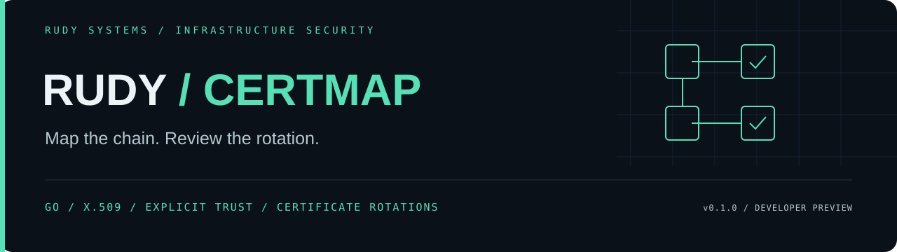

<p align="center"></p>

<p align="center">
 <a href="https://github.com/r4venrudy/rudy-certmap/actions/workflows/ci.yml"></a>
 
 
 <a href="LICENSE"></a>
</p>

<p align="center"><strong>Map the chain. Review the rotation.</strong></p>
<p align="center"><a href="#capabilities">Capabilities</a> · <a href="#install">Install</a> · <a href="#try-it">Examples</a> · <a href="docs/CONTRACT.md">Contract</a> · <a href="https://rudy.systems">Rudy Systems</a></p>

---

**Rudy CertMap reviews certificate bundles before they reach your systems.**
Give it public PEM/DER certificates and explicit trust anchors. It builds a
signature graph, verifies leaf paths against your chosen identity, time and
purpose, and compares certificate rotations without contacting a server.

Use it to review an mTLS rollout, investigate a missing intermediate, compare
cert-manager exports, or gate a certificate inventory in CI. The substantial core
is **Go**, using the standard library only. There are no runtime package downloads,
API keys, external vulnerability feeds or Python/JavaScript wrappers.

**v0.1.0 developer preview.** Certificate validation covers the supplied data and
settings. It does not establish current deployment, private-key possession,
revocation status, Certificate Transparency inclusion or browser-wide acceptance.

```text
certificate inventory + explicit trust anchors + evaluation policy
                              │
                    bounded PEM / DER parser
                              │
                ┌─────────────┼─────────────────┐
                ▼             ▼                 ▼
         issuer signatures  X.509 paths   rotation / SPKI diff
                │             │                 │
                └──────── JSON / SARIF / DOT ────┘
```

## Capabilities

| Capability | Implemented behavior |
| :--- | :--- |
| Trust-path verification | Explicit anchors, additional intermediates, DNS/IP identity, server/client/any EKU and evaluation time |
| Constraint enforcement | Go's X.509 verifier checks certificate validity, signatures, name constraints, path length, EKU and supported critical extensions |
| Issuer graph | Matches issuer/subject DER and checks parent signatures; names alone never establish an edge |
| Cross-signing | Reports multiple verified paths and certificates sharing an SPKI public key |
| Metadata policy | Expired/future/soon certificates, weak or unsupported keys, MD5/SHA-1 signatures, invalid CA declarations, missing server SANs |
| Rotation comparison | Added/removed DER identities and changed certificate sets sharing a public key; order/wrapping/duplicates do not cause changes |
| Pipeline outputs | Deterministic JSON at an explicit time, SARIF 2.1.0, DOT signature graphs, meaningful exit gates |
| Bounded parsing | Certificate-only PEM or one DER; byte, block, certificate, graph-complexity and reported-path limits |

System roots are **never** used. Supplying a root certificate in the inventory
alone does not make it trusted. Without `--roots`, leaf verification is explicitly
`not_checked`. CA certificates are inventory/graph subjects; path verification
runs for non-CA certificates in the main inventory.

## Install

Download the appropriate archive from [Releases](https://github.com/r4venrudy/rudy-certmap/releases)
and verify it against `SHA256SUMS.txt`. Each archive contains a standalone binary,
documentation and public synthetic examples. Linux/macOS binaries are named
`certmap`; Windows uses `certmap.exe`. No Go installation is needed to run them.

Build from source with **Go 1.26 or newer**:

```sh
git clone https://github.com/r4venrudy/rudy-certmap.git
cd rudy-certmap
go build -trimpath -o certmap ./cmd/certmap
go test ./...
go vet ./...
```

On Windows use `-o certmap.exe`. With Go installed, a tagged version can also be
installed as a Go tool:

```sh
go install github.com/r4venrudy/rudy-certmap/cmd/certmap@v0.1.0
```

## Try it

Examples are **synthetic public certificates**, evaluated at a fixed time so the
commands remain reproducible. No private keys are included or written by the
example generator. Place options **before** file arguments.

```sh
# Verify the service through its intermediate to an explicitly trusted root.
certmap inspect --roots examples/roots.pem --dns-name service.example.test --at 2026-10-17T12:00:00Z examples/bundle.pem

# Compare a reissued certificate that retains the same public key.
certmap diff examples/bundle.pem examples/rotated.pem

# Enforce the rotation review: exits 1 and still emits the complete diff.
certmap diff --fail-on-change examples/bundle.pem examples/rotated.pem

# Collect the missing-intermediate failure as SARIF without failing the pipeline.
certmap inspect --roots examples/roots.pem --at 2026-10-17T12:00:00Z --format sarif --fail-on none examples/missing-intermediate.pem

# Render cryptographic issuer edges (Graphviz is optional and installed separately).
certmap inspect --at 2026-10-17T12:00:00Z --format dot examples/bundle.pem > certificates.dot
dot -Tsvg certificates.dot -o certificates.svg
```

The first example has a verified three-certificate path. `rotated.pem` replaces
the leaf while retaining its SPKI and expires within 14 days of the example time.
The missing-intermediate inventory cannot build a path using the root alone.

`--purpose server` is the default. Use `client` for client-authentication EKU or
explicitly choose `any` to disable EKU restrictions. `--dns-name` accepts a DNS or
IP identity and requires explicit roots. It verifies the identity on **every**
inventory leaf; split multi-service inventories when each leaf needs a different
identity. Omitting the identity leaves hostname matching unchecked.

Without `--at`, current UTC time is used and recorded. The default expiry warning
window is 30 days; change it with `--expires-within 0..3650`. The key baseline is
RSA ≥2048, ECDSA ≥256 or Ed25519. This is a metadata policy, not a universal
cryptographic compliance certification.

### Exit behavior

| Exit | Meaning |
| :--- | :--- |
| 0 | Completed below the selected threshold |
| 1 | An audit threshold was reached, or `diff --fail-on-change` found a change |
| 2 | Input, command usage, complexity limit or output failure |

Audit defaults to `--fail-on error`. `warning` includes warnings and errors;
`none` collects valid reports. Reports go to stdout and diagnostics to stderr.
Threshold failures retain their complete report. With DOT output, use JSON or
SARIF separately to inspect the findings behind an exit gate.

## Validation

Tests create real synthetic certificate authorities and signatures in memory.
They cover cross-signed paths, missing intermediates, wrong anchors/hostnames/EKU,
name and path-length constraints, unknown critical extensions, validity periods,
weak keys, malformed/private-key inputs, byte/block/graph limits, deterministic
diffs, report escaping, gates and a built CLI subprocess.

```sh
go test ./... -cover
go test -race ./...                 # needs a supported C toolchain
go test ./certmap -run '^$' -fuzz '^FuzzParse$' -fuzztime 10s -parallel 2
```

CI verifies Go 1.26 and 1.27 on Linux, Windows and macOS, with Linux race and fuzz
checks. Release automation repeats those checks before packaging. Builds for
Linux ARM64 and macOS Intel are cross-compiled; executing every release target on
physical hardware is not claimed. Consult the live workflow for actual results.

```text
certmap/              Parser, certificate policy, trust graph, diff, SARIF and DOT
internal/cli/         Command implementation and subprocess tests
internal/testpki/     Synthetic public-certificate generator; keys stay in memory
cmd/certmap/          Standalone CLI
cmd/examplegen/       Regenerate examples into a new directory
examples/            Public synthetic inventories and trust anchors
scripts/package.py   Release archive assembly; never part of the analysis core
```

Regenerate examples with `go run ./cmd/examplegen new-examples`. It refuses an
existing output directory. Fresh ephemeral keys change certificate fingerprints;
the policy behavior at the example time stays the same.

Read the [input/output contract](docs/CONTRACT.md),
[security boundaries](SECURITY.md) and [contribution guide](CONTRIBUTING.md).
Verification follows Go's [X.509 implementation](https://pkg.go.dev/crypto/x509#Certificate.Verify).
This project does not implement its own certificate cryptography or claim full
support for every X.509 profile.

---

<p align="center"><a href="LICENSE">MIT licensed</a> · Built by <a href="https://rudy.systems">Rudy Systems</a> · <a href="https://github.com/r4venrudy">r4venrudy</a></p>
